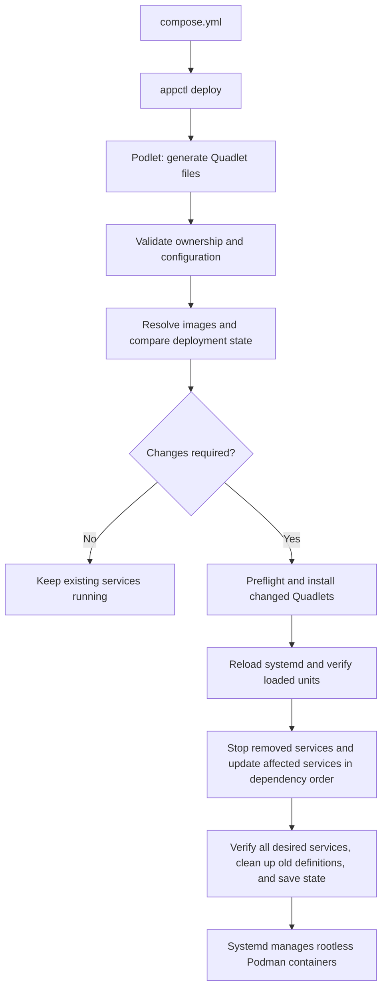

# appctl

A lightweight, Compose-driven deployment and service management CLI for **rootless Podman, Quadlet, and systemd** on Linux.

Maintain a `compose.yml` for each application, deploy only what has changed, and manage running services through a single command. appctl uses [Podlet](https://github.com/containers/podlet) to generate Quadlet definitions and delegates container lifecycle management to systemd instead of maintaining its own process supervisor.

Designed for self-hosted applications, single-server deployments, and CI/CD workflows where Kubernetes would add unnecessary complexity.


## Features

- **Compose as the deployment source** — generate `.container`, `.network`, and `.volume` files automatically with Podlet.
- **Incremental deployment** — compare image IDs, generated Quadlet definitions, referenced configuration files, and supported local drop-ins; restart only affected services.
- **Local image caching** — reuse existing versioned images; explicitly refresh remote images with `--pull`.
- **Application lifecycle management** — start, stop, restart, and check the runtime state of a project or one service.
- **Compose resource inspection** — list published ports, exposed ports, volumes, and file mounts before deployment.
- **Ownership-aware cleanup** — remove services deleted from Compose without deleting application data, volumes, networks, or images.
- **Conflict detection** — check project ownership, unit names, and container/resource names before applying changes.
- **Deployment and operation history** — record structured JSON events, durations, outcomes, and image information, with automatic retention limits.
- **Concurrent operation protection** — serialize appctl operations for the deployment account using a file lock.
- **Operator-friendly output** — readable change reasons, status tables, summaries, error diagnostics, and optional verbose output; ANSI colors are disabled for non-interactive output.
- **Configurable deployment environment** — override the deployment account, application root, and Podlet compatibility target with environment variables.
- **Minimal dependencies** — a single Python script using only the standard library; no pip packages or external database.

## How it works



Compose is used as a **configuration format**, not as the runtime orchestrator. appctl does not call `podman compose up` or `docker compose up`. Generated Quadlet definitions are managed by appctl; systemd manages the running services and their restart policies.

## Requirements

| Component | Requirement |
| --- | --- |
| Operating system | Linux with systemd user services (Debian 13 is the reference environment) |
| Python | 3.9 or later; standard library only |
| Podman | Rootless Podman with Quadlet support; 5.4 is the default compatibility target and reference version |
| Podlet | A release supporting Compose conversion, `--podman-version` for the chosen compatibility target, `--absolute-host-paths`, and the other flags used by appctl |
| Deployment account | A configured non-root user (default: `www`) with rootless Podman and an active systemd user manager |
| Application directory | `$APPCTL_BASE_DIR/<app>/compose.yml` (default: `/var/www/<app>/compose.yml`) |

The defaults are designed for the reference environment but can be overridden without modifying the script. Changing the Podlet compatibility target does not install or upgrade Podman, and does not guarantee compatibility with every Podman version. This is not a general-purpose Compose compatibility layer.

## Installation

**appctl has zero PyPI dependencies.** The single `appctl.py` script uses only the Python 3.9+ standard library. Run it directly with Python. Podman, Podlet, and systemd are separate Linux system requirements.

### 1. Prepare rootless Podman

Install Python, Podman, and Podlet using the appropriate packages or release binaries for your distribution. On Debian, the core packages can be installed with:

```bash
sudo apt-get update
sudo apt-get install -y python3 podman uidmap
```

Install Podlet separately if necessary using its [release binaries](https://github.com/containers/podlet/releases).

Choose a dedicated non-root deployment account (default: `www`), or use an existing rootless Podman account configured through `APPCTL_USER`. The examples below use the defaults. Configure its subordinate UID/GID ranges and rootless networking according to the [Podman rootless guide](https://github.com/containers/podman/blob/main/docs/tutorials/rootless_tutorial.md).

Enable lingering so its systemd user manager can run without an interactive login and start services after boot:

```bash
sudo loginctl enable-linger www
loginctl show-user www -p Linger
```

### 2. Install appctl

From the repository checkout, install `appctl.py` as a root-owned executable:

```bash
sudo install -o root -g root -m 0755 appctl.py /usr/local/bin/appctl
appctl --version
```

### 3. Verify the deployment environment

Run deployment commands **as the configured non-root account**, not as root. The following example uses the default account `www`. If using an administrator account, the following opens a shell with access to the deployment user's systemd session, including when `www` has a non-login shell:

```bash
uid=$(id -u www)
sudo -u www -H env \
  XDG_RUNTIME_DIR="/run/user/$uid" \
  DBUS_SESSION_BUS_ADDRESS="unix:path=/run/user/$uid/bus" \
  bash
```

In that shell:

```bash
id
podman info
podlet --version
systemctl --user list-units
```

For private registries, store the login credentials outside the application directory:

```bash
mkdir -p "$HOME/.config/containers"
chmod 700 "$HOME/.config/containers"
podman login --authfile "$HOME/.config/containers/auth.json" registry.example.com
chmod 600 "$HOME/.config/containers/auth.json"
```

Replace `registry.example.com` with your registry. appctl defaults to this auth file unless `REGISTRY_AUTH_FILE` is already set. Public images do not require a private registry login.

## Configuration

appctl reads these environment variables at invocation time. Unset variables use the defaults; empty or invalid values are rejected. No source-code edits are required.

| Variable | Default | Description |
| --- | --- | --- |
| `APPCTL_USER` | `www` | Expected non-root deployment account. Must match the actual invoking user; appctl never switches users. |
| `APPCTL_BASE_DIR` | `/var/www` | Absolute path to the application root; each project has its own `<app>/compose.yml`. |
| `APPCTL_PODMAN_VERSION` | `5.4` | Podlet's Quadlet compatibility target in `major.minor` form (for example, `5.4`). Select a target supported by your Podlet release and installed Podman. |

For example, to use an existing deployment account named `deploy` and an application root at `/opt/apps`, provision the directory as an administrator:

```bash
sudo install -d -o deploy -g "$(id -gn deploy)" -m 0750 /opt/apps/myapp
sudo loginctl enable-linger deploy
```

Run the following in the `deploy` account's shell with its rootless Podman environment and systemd user bus available (see Installation above):

```bash
export APPCTL_USER=deploy
export APPCTL_BASE_DIR=/opt/apps
export APPCTL_PODMAN_VERSION=5.4

# With /opt/apps/myapp/compose.yml in place:
appctl deploy myapp
appctl status myapp
```

For interactive Bash sessions, persist these exports in the deployment user's `~/.bashrc` (or your shell's equivalent). For CI/CD, scheduled jobs, or non-interactive SSH commands, explicitly set the variables in the job environment; do not assume interactive shell startup files will be loaded.

The settings are read from the process environment, not from the application's `.env` file or Compose file. Explicitly setting `APPCTL_USER=root` does not permit rootful execution. `--help` and `--version` remain available without a configured deployment account. Use `--verbose` to display the effective account, application root and compatibility target.

Keep these settings consistent for all operations on a deployment account. The application root changes where Compose is read; it does not relocate persistent bind mounts, installed Quadlets, registry authentication or state. Project names and resource ownership remain scoped to the deployment account's existing state and Quadlet directories, not to the application root. Changing the account or application root is not a migration mechanism. Do not reuse project names across unrelated application roots within the same account.

## Quick start

Deploy a small Nginx service using an external configuration file. This example is intended to be run locally and publishes only to the host loopback interface.

As an administrator, create the project directory:

```bash
sudo install -d -o www -g "$(id -gn www)" -m 0750 /var/www/demo
```

As `www`, create `/var/www/demo/compose.yml`:

```yaml
name: demo

services:
  demo-web:
    image: docker.io/library/nginx:1.28-alpine
    container_name: demo-web
    pull_policy: never
    restart: always
    stop_grace_period: 30s
    ports:
      - "127.0.0.1:18080:8080"
    volumes:
      - /var/www/demo/default.conf:/etc/nginx/conf.d/default.conf:ro
    logging:
      driver: journald
```

Create `/var/www/demo/default.conf`:

```nginx
server {
    listen 8080;
    location / {
        default_type text/plain;
        return 200 "Hello from appctl!\n";
    }
}
```

Deploy the project and verify it:

```bash
appctl deploy demo
appctl status demo
curl http://127.0.0.1:18080/
```

Modify `default.conf` and run `appctl deploy demo` again. appctl detects the file content change and restarts the affected service. If nothing has changed and the expected container is running, deployment is skipped.

The image tag above is illustrative. Use immutable release tags or digests in production, and publish a new tag whenever an image changes.

### Recommended project layout

```text
/var/www/
├── demo/
│   ├── compose.yml
│   └── default.conf
└── myapp/
    ├── compose.yml
    ├── .app.toml
    ├── .env
    └── data/
```

Application code and runtime dependencies belong in the container image. Host configuration and persistent data belong in the project directory. Bind-mount configuration files individually (preferably read-only) and data directories separately. Do not mount an empty host application directory over the image's application binaries.

For multi-service projects, define an explicit shared Compose network if services need to communicate by service name. An external reverse proxy can connect through explicitly published host ports; restrict those ports to trusted networks with host firewall rules.

## Commands

```text
appctl deploy APP [--pull] [--force]
appctl start APP [SERVICE]
appctl stop APP [SERVICE]
appctl restart APP [SERVICE]
appctl status APP [SERVICE]
appctl inspect APP [SERVICE]
appctl history APP [--limit N]
appctl gc
appctl --help
appctl --version
```

| Command | Description |
| --- | --- |
| `deploy` | Read Compose, generate and validate Quadlets, resolve images, and apply incremental changes to the project. |
| `deploy --pull` | Check the registry even when an image is cached locally. Only restart services if other deployment conditions require it. |
| `deploy --force` | Start or restart every desired service, even if its deployment fingerprint is unchanged. |
| `start` | Start already-deployed services using installed Quadlet definitions. |
| `stop` | Temporarily stop already-deployed services without deleting deployment definitions or application data. |
| `restart` | Restart already-deployed services using installed definitions. |
| `status` | Show systemd state, container state, image reference, and abbreviated image ID. |
| `inspect` | Show ports and mounts declared in the current Compose file for a project or one service. |
| `history` | List recent deployment and lifecycle operations (20 entries by default). |
| `gc` | Clean expired and excess history and old temporary state files across all projects. |

`APP` is the directory name under `APPCTL_BASE_DIR` (default: `/var/www`). For lifecycle and status commands, `SERVICE` selects a generated `.container` filename stem, normally the corresponding Compose service name. Omit it to operate on all managed container services in the project.

```bash
appctl deploy myapp
appctl deploy myapp --pull --force
appctl stop myapp myapp-api
appctl start myapp myapp-api
appctl restart myapp
appctl status myapp
appctl history myapp --limit 50
appctl gc
```

### Inspect Compose ports and mounts

```bash
appctl inspect myapp              # All services in compose.yml
appctl inspect myapp myapp-api    # One service
```

`inspect` uses Podlet to read the current `compose.yml` and works before the first deployment. The port table distinguishes host mappings declared with `ports` from container ports declared with `expose`. It also indicates host networking. The mount table shows the source, container path, and configured options for named volumes, anonymous volumes, bind-mounted files or directories, tmpfs, and mounted secrets.

The report reflects configuration declarations. Host ports assigned automatically by Podman and ports opened by the application at runtime depend on the running container. Use the same project and service names as with `deploy` and `status`.

### Output options

Use `--verbose` (or `-v`) for child commands and detailed diagnostic output. Use `--no-color` or the `NO_COLOR` environment variable to disable ANSI colors. These flags may be placed before or after the subcommand.

```bash
appctl deploy myapp --verbose
NO_COLOR=1 appctl status myapp
```

Illustrative output for an unchanged project:

```text
appctl 4.2  |  DEPLOY  demo
----------------------------------------------------------------

[1/4] Generate & validate Quadlet
  OK      1 service(s), 0 resource definition(s) validated

[2/4] Resolve images & build deployment plan
  CACHE   library/nginx:1.28-alpine
  SKIP    demo-web.service
           unchanged
  INFO    0 to update, 1 unchanged, 0 to remove

----------------------------------------------------------------
NO CHANGES  |  0.23s  |  1 unchanged  |  1 cached
```

Exit codes: `0` indicates success or no changes, `1` an operation failure, `2` invalid CLI arguments, and `130` an operator interrupt. `status` reports runtime state; a stopped service alone does not make the status command fail.

## Deployment behavior

### Incremental updates

A service's deployment fingerprint includes:

- The generated Quadlet file content and resolved local image ID.
- SHA-256 hashes of regular files mounted using supported `Volume=` or bind `Mount=` definitions, and files referenced by `EnvironmentFile=`.
- Supported local Quadlet and systemd drop-in configuration files, including service-name prefixes under `$XDG_CONFIG_HOME/systemd/user` (default: `~/.config/systemd/user`).

Configuration file names are not restricted to `.app.toml` or `.env`. Files such as `.appprod.toml`, `settings.json`, and `config.yaml` are tracked when explicitly referenced. Missing required bind sources cause deployment to fail during preflight. Directory contents are deliberately not hashed recursively, so uploaded files, model files, and other persistent data do not trigger deployments.

Configuration changes are detected **when `appctl deploy` runs**; appctl is not a file watcher. For unchanged definitions, no `daemon-reload` is required merely because a mounted configuration file or image ID changed.

Use `pull_policy: never` explicitly in each Compose service. appctl resolves images before starting services and prevents implicit registry pulls during systemd startup. Prefer versioned image references; if a mutable tag has been updated, use `--pull` to refresh it.

When definitions change, appctl checks the candidate Quadlets with the Podman generator in a temporary directory. It verifies that systemd loads the expected units before stopping removed services. Updates follow the loaded systemd dependency order, and deployment success requires all desired services to be active with the expected images.

### Lifecycle semantics

`start`, `stop`, and `restart` use installed Quadlet definitions, not pending edits to Compose. They do not regenerate Quadlets, pull images, or update the last successful deployment fingerprint. A recreated container can read the current content of mounted configuration files.

Stopping a service is temporary. systemd will not immediately restart a service explicitly stopped by the operator, but a subsequent deployment or system boot may start it again. Quadlet can remove the stopped runtime container object; this is normal and does not delete images, generated Quadlet definitions, or persistent data. systemd dependency relationships may affect other services.

### Resource ownership and removal

Generated Quadlets are installed in the deployment user's `$XDG_CONFIG_HOME/containers/systemd` (default: `~/.config/containers/systemd`). The project manifest records resource ownership and appctl checks for conflicts before mutating managed resources. Use unique service, container, volume, and network names across projects sharing a deployment account; Compose project names alone do not guarantee isolation in a shared Quadlet directory.

If a service is removed from Compose, appctl stops its owned systemd unit. It removes the old `.container` file after the desired services pass runtime verification and prunes its deployment state. A replacement can take over the old service's port after the old service stops. Networks, named volumes, their reserved definitions, local images, and host data remain. Changed network or volume definitions require manual migration. Keep at least one container service in Compose.

The manifest also reserves named volumes referenced directly by containers, including volumes for which Podlet emits no `.volume` file. Services in the same project can share a named volume. Each named volume is reserved to one project per deployment account.

By design, appctl rejects unmanaged Quadlets or runtime objects with conflicting names and does not automatically adopt pre-existing services. Do not use another deployment tool concurrently against appctl-managed resources or directly edit generated definitions.

## State and operation history

```text
~/.local/state/appctl/         # or $XDG_STATE_HOME/appctl
├── deploy.lock
└── demo/
    ├── manifest.json          # owned files, units and resource identities
    ├── state.json             # last successful deployment state per service
    └── history/               # structured operation records
        └── <timestamp>-<id>.json
```

Deploy, start, stop, and restart operations record successes, failures, and no-op results. `status` and `history` are read-only operations and are not recorded as history entries. An interrupted operation may leave a `running` history entry. Records include event details and image identities where available; configuration values are not intentionally recorded. Keep credentials out of image references and review diagnostic output before sharing it.

History is automatically pruned on mutating operations across all projects. Defaults are **90 days and at most 100 records per project**. Change `DAYS` and `MAX_HISTORY` in the script to adjust retention. `appctl gc` also removes expired abandoned state-write temporary files. Current ownership manifests and active deployment state are not age-pruned.

Do not delete the manifest/state directory to clear history: these files are needed for safe ownership tracking and incremental deployment.

## CI/CD integration

Build and publish application images in your CI pipeline, then update the desired image reference in the server's Compose file. Run appctl as the deployment account with access to its systemd user manager:

```bash
appctl deploy myapp --no-color
```

If using non-default configuration, export the same `APPCTL_*` settings in the CI job environment before invoking the tool. A successful unchanged deployment exits with status `0`. The tool automatically acquires a per-account global lock, so multiple invocations cannot mutate its deployment state simultaneously. This lock does not protect Compose or configuration files from edits made by other programs; coordinate those writes with deployment jobs.

appctl is intentionally not a build system and does not implement remote orchestration. Registry authentication, SSH access, artifact publishing, and deployment authorization are handled outside the tool.

## Troubleshooting

```bash
appctl deploy myapp --verbose
systemctl --user status myapp-api.service
journalctl --user -u myapp-api.service -n 80 --no-pager
podman ps -a
```

For Quadlet generation issues, inspect the generated systemd unit and, on distributions with the standard generator path, use its dry-run mode:

```bash
systemctl --user cat myapp-api.service
/usr/lib/systemd/system-generators/podman-system-generator --user --dryrun
```

- **Wrong deployment account or path:** check `APPCTL_USER` and `APPCTL_BASE_DIR`. Run the command as the configured non-root account.
- **Unsupported conversion target:** check `APPCTL_PODMAN_VERSION`, `podman --version`, and `podlet --help`; use a target compatible with both tools.
- **User bus unavailable:** check the active user manager, `XDG_RUNTIME_DIR`, and lingering configuration.
- **Permission denied on a bind mount:** check rootless UID/GID mappings and file permissions. The container's numeric user is not necessarily the same as the host deployment user.
- **Name conflict:** check existing Quadlets, runtime resources, and the owning project's manifest. Do not delete unrelated resources to bypass a conflict.
- **Deployment failed partway through:** inspect logs and history, correct the problem, and run `deploy` again. Partial changes may already have been applied.

## Scope and limitations

appctl focuses on ordinary long-running, image-based services in a single rootless Podman environment. It currently does not provide:

- HTTP or application-level readiness checks, automatic rollback of running services, or blue/green deployments. appctl restores changed Quadlet files if live unit validation fails. Deployment verification checks systemd and the expected running container image.
- Multi-host scheduling, high availability, load balancing, or image building.
- Arbitrary Compose/Quadlet features, including pods, build/image units, oneshot/template units, custom aliases, dynamic resource specifiers, or raw `PodmanArgs`/`GlobalArgs`.
- Recursive configuration-directory hashing, secret-value change tracking, comprehensive host-port conflict auditing, or full detection of external runtime changes.
- Automatic adoption of existing services, persistent enable/disable commands, or automatic deletion of networks, volumes, or images.

Use static, unique resource names, explicit bind paths and `pull_policy: never`. Keep identity, mount, and lifecycle settings in Compose instead of overriding them in local drop-ins. Validate changes on a non-production host before deploying. This is a trusted-operator tool, not a multi-tenant security boundary.

## Contributing

Run the regression suite with `python3 -m unittest discover -s tests`.

Bug reports, documentation improvements, reproducible compatibility reports, and pull requests are welcome. When reporting deployment issues, include the appctl, Podman, Podlet, and OS versions, a sanitized Compose example, and relevant `--verbose` output. Never include registry credentials, environment secrets, or private configuration contents.

## Related projects

- [Podman](https://podman.io/) — rootless container runtime.
- [Quadlet documentation](https://docs.podman.io/en/v5.4.2/markdown/podman-systemd.unit.5.html) — systemd integration for Podman.
- [Podlet](https://github.com/containers/podlet) — Compose-to-Quadlet conversion.
- [Compose Specification](https://compose-spec.github.io/compose-spec/spec.html) — the Compose configuration model.
